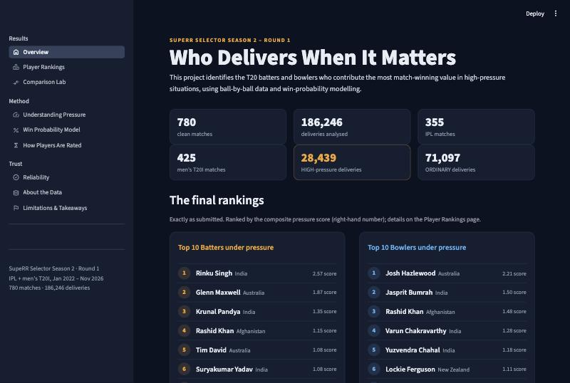

# Who Delivers When It Matters — SupeRR Selector Season 2, Round 1

An interactive Streamlit dashboard for a data-driven system that ranks the T20 batters and bowlers who deliver the most
match-winning value under pressure. It covers IPL and men's T20I ball-by-ball data, January 2022 – November 2026
(780 clean matches, 186,246 deliveries).

**Method in one line:** pressure = how much a single delivery can change who wins (a win-probability Leverage Index);
performance = opponent- and context-adjusted win probability added on high-pressure balls, compared with each player's
own ordinary baseline.



## Final submitted rankings

| # | Batters | Bowlers |
|---|---|---|
| 1 | Rinku Singh | Josh Hazlewood |
| 2 | Glenn Maxwell | Jasprit Bumrah |
| 3 | Krunal Pandya | Rashid Khan |
| 4 | Rashid Khan | Varun Chakravarthy |
| 5 | Tim David | Yuzvendra Chahal |
| 6 | Suryakumar Yadav | Lockie Ferguson |
| 7 | Harry Brook | Matheesha Pathirana |
| 8 | David Miller | Gudakesh Motie |
| 9 | Sam Curran | Krunal Pandya |
| 10 | Jos Buttler | Harshit Rana |

The app checks on every load that its data reproduces this exact order and stops with an error if it does not.

## Pages

| Section | Page | What it shows |
|---|---|---|
| Results | Overview | KPIs, both top-10s, what "pressure" means, how the pipeline works |
| Results | Player Rankings | Full ranking tables (top 10 or all eligible), player profiles, HIGH vs ORDINARY box scores, match-by-match pressure WPA |
| Results | Comparison Lab | Any two eligible players of a role, side by side |
| Method | Understanding Pressure | Leverage Index, real example states, LI by over, pressure tiers, CCPI comparison |
| Method | Win Probability Model | Features, Brier scores, calibration, grouped cross-validation |
| Method | How Players Are Rated | WPA with two real deliveries, ridge adjustment, composite formula, worked example |
| Trust | Reliability | Bootstrap top-10 probabilities, sensitivity variants, weight sensitivity, split-half reliability |
| Trust | About the Data | Scope, competition tiers, exclusions, reconstruction decisions, data-quality checks |
| Trust | Limitations & Takeaways | Limitations and conclusion |

## Repository structure

```
app.py                     # entry point (st.navigation); runs the data guard on every page
views/                     # one file per page (named views/, not pages/, to avoid Streamlit's legacy auto-discovery)
components/ui.py           # CSS, KPI cards, callouts, ranking cards, glossary
components/charts.py       # Plotly chart builders with one shared theme
utils/data.py              # cached CSV/JSON loaders + submitted-ranking check
data/                      # precomputed outputs only (~360 KB); no raw ball-by-ball data
tests/test_dashboard.py    # page smoke tests, widget interaction tests, value cross-checks
screenshots/               # page screenshots
.streamlit/config.toml     # dark theme
requirements.txt
```

## Run locally

```bash
pip install -r requirements.txt
streamlit run app.py
```

Tests (optional; pytest is not needed to run the app):

```bash
python tests/test_dashboard.py
```

The value cross-checks against `handoff/` and `outputs/tables/` run only when the dashboard sits inside the analysis
repository (`SupeRR_Round1_Work/dashboard`). In a standalone deployment they are skipped automatically.

## Deploy on Streamlit Community Cloud

1. Create a new **public** GitHub repository, e.g. `superr-selector-s2-pressure-dashboard`.
2. Upload the **contents of this `dashboard/` folder** to the repository root, so that `app.py` is at the top level.
   From a terminal:
   ```bash
   cd SupeRR_Round1_Work/dashboard
   git init && git add . && git commit -m "SupeRR Selector S2 Round 1 dashboard"
   git branch -M main
   git remote add origin https://github.com/<your-username>/superr-selector-s2-pressure-dashboard.git
   git push -u origin main
   ```
   Or use GitHub's web UI: **Add file → Upload files**, then drag in every file and folder here, including `.streamlit/`.
3. Go to <https://share.streamlit.io>, sign in with GitHub, and click **Create app → Deploy a public app from GitHub**.
4. Repository: your repo · Branch: `main` · Main file path: **`app.py`**.
5. Under **Advanced settings**, choose **Python 3.12**. No secrets or environment variables are needed.
6. Optionally set a custom subdomain, e.g. `superr-pressure.streamlit.app`, then click **Deploy**. The first build takes 2–4 minutes.
7. Open the public URL, click through every page, and add the URL to your Unstop submission.

**Suggested app title:** *Who Delivers When It Matters — SupeRR Selector S2*
**Suggested description:** *Interactive companion to my SupeRR Selector Season 2 Round 1 submission: a win-probability
Leverage Index identifies high-pressure deliveries, and opponent-adjusted win probability added ranks the T20 batters and
bowlers who deliver most when it matters, with full uncertainty and robustness checks.*

## Where the numbers come from

Everything in `data/` is produced by the analysis pipeline; the dashboard never re-runs the analysis.

| File | Source |
|---|---|
| `ratings_batters.csv`, `ratings_bowlers.csv` | `src/s12_dashboard_export.py`, using the final definition in `s11`/`s10`. The top 10 is asserted identical (order and values) to `handoff/TOP10_*.csv`. Includes every eligible player (56 batters, 52 bowlers) plus HIGH/ORDINARY box scores. |
| `match_pressure_*.csv` | Per-match net WPA on HIGH balls (the basis of *consistency*), from `s12` |
| `li_by_over.csv`, `li_histogram.csv`, `delivery_categories.csv`, `example_states.csv`, `wpa_examples.csv` | Aggregates of `outputs/processed/balls_with_pressure.parquet`, from `s12` |
| `tier_profile.csv`, `bootstrap_rank_intervals.csv`, `variants_comparison.csv`, `weight_sensitivity.csv`, `split_half_reliability.csv`, `population_reference.csv` | Verbatim copies of `outputs/tables/final_*.csv` (`s11_final_validation.py`) |
| `calibration_bins.csv`, `calibration_subgroups.csv` | `outputs/tables/phase1_*` (`s06`) |
| `ccpi_comparison.csv`, `ccpi_weight_r2.csv`, `close_vs_lopsided.csv` | `outputs/tables/phase2_*` (`s07`) |
| `competition_tiers.csv`, `data_quality_checks.csv`, `data_edits_log.csv`, `duplicate_names.csv`, `extras_calibration.json` | Phase 0 / 0b outputs (`s05`, `s05b`) |
| `match_exclusions.csv` | Counts documented in `docs/PHASE_0_SUMMARY.md` (no CSV of these existed) |
| `manifest.json` | Key counts and thresholds; Brier 0.1765 / naive 0.2499 from `docs/PHASE_1_SUMMARY.md` |

To regenerate: from `SupeRR_Round1_Work/`, run `python src/s12_dashboard_export.py`. It needs the processed parquet files and takes about a minute.

## Known gaps

- **Bootstrap probabilities exist only for the top 20 of each list.** Other players show "—".
- **The win-probability model object was not saved**, so the dashboard cannot compute live what-if scenarios. The
  "15 off 12" example uses averages of real deliveries in similar states, with sample sizes shown.
- **The CCPI comparison and close-vs-lopsided check come from Phase 2** (all deliveries, before the final tier
  definition). They are labelled as such.
- **Run equations use reconstructed totals** (extras estimated to about ±1.7 runs), so a displayed requirement can be
  fractional, e.g. Rinku Singh's last-ball six shows "2.3 needed".
